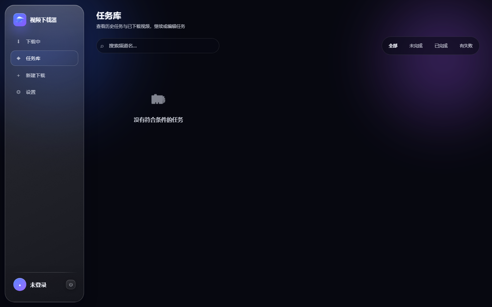
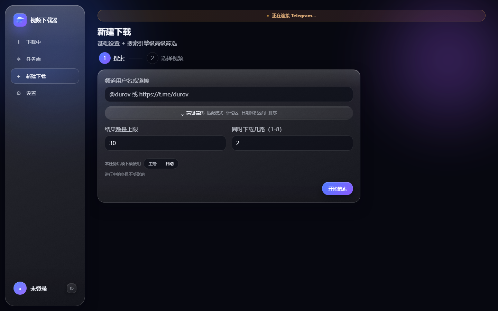
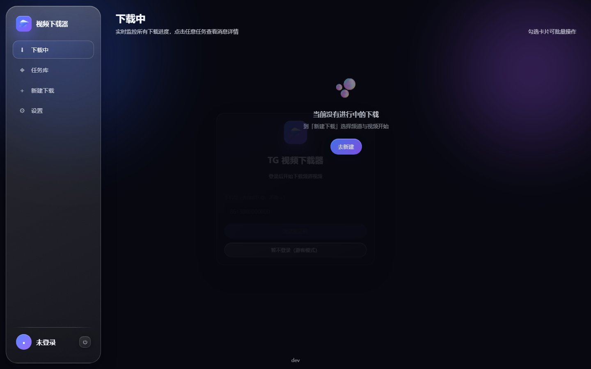
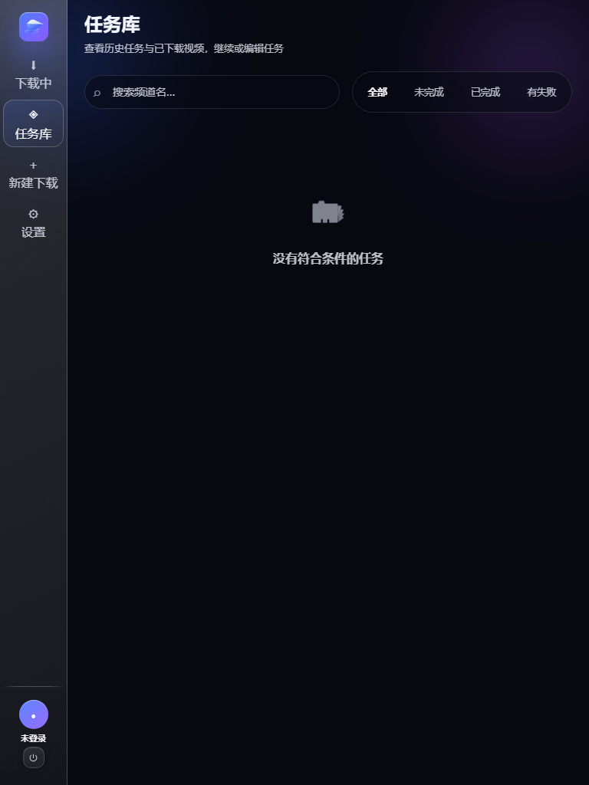
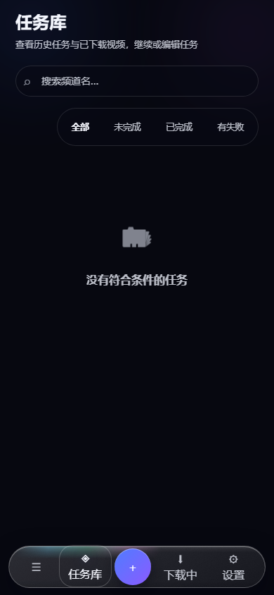
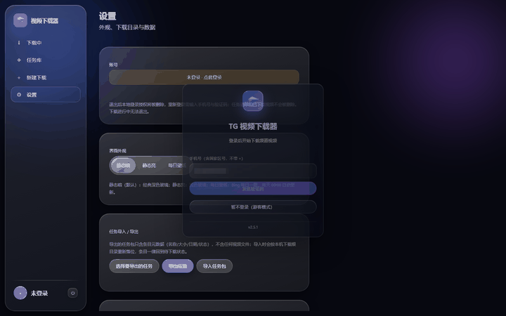

# TG 视频下载器

[](https://github.com/xmiqz/tg-video-downloader/releases)
[](https://github.com/xmiqz/tg-video-downloader/releases)
[](LICENSE)
[](https://www.python.org/)
[](#快速开始)

Telegram 频道视频批量下载工具。纯 Python 实现，基于 [Telethon](https://github.com/LonamiWebs/Telethon)，不依赖外部下载器或 ffmpeg。

Windows 提供原生 WebView2 图形界面与控制台 TUI；Linux、Docker、NAS 提供浏览器版；macOS 提供命令行版。



## 目录

- [产品定位](#产品定位)
- [核心功能](#核心功能)
- [快速开始](#快速开始)
- [浏览器版部署（Linux / Docker / NAS）](#浏览器版部署linux--docker--nas)
- [首次使用](#首次使用)
- [桌面版基本用法](#桌面版基本用法)
- [命令行 / TUI 用法](#命令行--tui-用法)
- [配置参数](#配置参数)
- [外观与动效](#外观与动效)
- [常见问题](#常见问题)
- [兼容性](#兼容性)
- [已知限制](#已知限制)
- [隐私与安全](#隐私与安全)
- [合规与免责声明](#合规与免责声明)
- [License](#license)
- [反馈与致谢](#反馈与致谢)

## 产品定位

给需要**成批保存 Telegram 频道视频**的用户一个开箱即用的离线工具：登录一次 Telegram，按频道筛选视频，勾选后交给队列自动下载，关机重开还能接着下。

它不依赖浏览器插件、不依赖网页端的“保存到本地”、也不调用 ffmpeg 转码——下载到的就是频道里原始的视频文件。数据只保存在本机或你自己的 NAS 上。

适合的场景：

- 订阅了视频频道，想把某批内容归档到本地或 NAS
- 需要按关键词、体积、日期精确筛选后再下载，而不是一条条手动点
- 大文件、长时间下载，希望断点续传、失败单独重试

## 核心功能

- **批量扫描与下载**：按频道扫描视频，支持 1 GB 以上大文件
- **服务端关键词搜索**：与 Telegram App 内搜索同一机制，支持包含 / 排除词，可交互勾选
- **高级筛选**：精确短语 / 全部词 / 任一词 / 模糊匹配 / 正则表达式五种匹配模式；按体积上下限、日期范围、频道或评论区范围过滤；按日期或体积排序；条数上限可控
- **多路并发**：可选 1–8 路同时下载，单视频内部 8 MB 分片 × 4 连接并行
- **任务级断点续传**：关机、关窗口后重启可继续未完成任务；分片不重下，失败视频可单独重试
- **moov 无损快启**：下载完成自动把 MP4 的 moov 移到文件开头，任何播放器即点即播，不重新编码
- **磁盘空间检查**：下载前按待下总大小粗估，空间不足时提醒
- **大任务自动拆分**：单任务超过 999 条，或同时超过 300 条且总体积超过 300 GB 时，自动按每片 200 GB / 999 条拆分
- **内容去重**：文件名与大小都相同的消息只保留最新
- **内置登录凭证**：自带 Telegram 官方公开客户端 api_id / api_hash，开箱即用；也可替换为自己申请的凭证

## 快速开始

到 [Releases](https://github.com/xmiqz/tg-video-downloader/releases) 下载对应平台文件。Release 资产名使用 ASCII 命名（GitHub 会剥离中文名），中文说明见资产标签。

| 平台 | Release 文件名 | 形态 |
| --- | --- | --- |
| Windows x64 | `TGVideoDownloader.exe` | 图形界面（GUI） |
| Windows x64 | `TGVideoDownloader_TUI.exe` | 控制台（TUI） |
| Windows ARM64 | `TGVideoDownloader_ARM64.exe` | 图形界面（GUI） |
| Windows ARM64 | `TGVideoDownloader_TUI_ARM64.exe` | 控制台（TUI） |
| Linux x64 | `TGVideoDownloader_linux_x64` | 命令行 |
| Linux ARM64 | `TGVideoDownloader_linux_arm64` | 命令行 |
| macOS Intel | `TGVideoDownloader_mac_x64` | 命令行（另附 `.command` 双击启动） |
| macOS Apple Silicon | `TGVideoDownloader_mac_arm64` | 命令行（另附 `.command` 双击启动） |
| Docker amd64 / arm64 | `ghcr.io/xmiqz/tg-video-downloader` | 浏览器版镜像 |

**怎么选**：想在 Windows 上点点鼠标就用，下载 `TGVideoDownloader.exe`；在服务器、NAS 或远程机器上用，走下面的浏览器版（Docker）；习惯终端快捷键，用 TUI 或 Linux / macOS 命令行版。

> 桌面版暂未做代码签名，Windows SmartScreen 可能提示“未知发布者”，点“更多信息 → 仍要运行”即可。

## 浏览器版部署（Linux / Docker / NAS）

浏览器版与 Windows 图形界面共用同一套界面与任务引擎，在浏览器里完成登录 Telegram、筛选、下载与任务管理。

### Docker Compose（推荐）

仓库根目录提供 [compose.yaml](./compose.yaml)：默认使用命名卷 `tg-video-downloader-data`，无需提前在宿主机创建 `./data` 或改属主；容器以 uid/gid `10001:10001` 运行，只读根文件系统、`cap_drop: ALL`、`no-new-privileges`。

在 NAS 或服务器上建一个部署目录，放入 `compose.yaml`，执行：

```bash
docker compose up -d
docker compose ps
docker compose logs -f --tail=100
```

首次启动读取一次性初始化令牌：

```bash
docker compose exec tg-video-downloader cat /data/.setup-token
```

浏览器打开 `http://NAS地址:8787`，输入初始化令牌并设置**管理员密码**。这个密码只保护 Web 管理界面，不是 Telegram 两步验证密码。初始化成功后 `.setup-token` 会被自动删除。

### 指定宿主机目录

先在 NAS 上建目录并授权给容器用户，再把 compose 中的命名卷改为绑定挂载：

```bash
mkdir -p /vol1/1000/docker/tg-video-downloader-data
chown -R 10001:10001 /vol1/1000/docker/tg-video-downloader-data
```

```yaml
    volumes:
      - /vol1/1000/docker/tg-video-downloader-data:/data
```

备份、升级、回滚的完整操作见 [docs/nas-backup-restore.md](./docs/nas-backup-restore.md)。放在 HTTPS 反向代理后面（域名 / 公网访问）的配置见 [docs/nas-reverse-proxy.md](./docs/nas-reverse-proxy.md)。

### 从源码运行

```bash
python -m pip install -r requirements-server.txt
python -m server_app --host 0.0.0.0 --port 8787 --data-dir ./data
```

只在本机访问时省略 `--host`，服务默认只监听 `127.0.0.1`。

> 普通 HTTP 只适合可信局域网。不要把 8787 端口直接暴露到公网；跨网络访问请用 HTTPS 反向代理，并设置 `TGDL_COOKIE_SECURE=1`。

### Linux / macOS 命令行版

```bash
chmod +x TGVideoDownloader_linux_x64
./TGVideoDownloader_linux_x64
```

macOS 双击附带的 `.command` 文件即可在终端启动。

## 首次使用

1. 启动程序后输入手机号（含国家区号，不带 `+`，例如 `8613800000000`）
2. 在 Telegram App 中查收验证码并输入
3. 若开启了两步验证，输入两步验证密码

程序内置 Telegram 官方公开客户端凭证，无需自行申请 API。若内置凭证被临时限制，程序会引导你到 [my.telegram.org/apps](https://my.telegram.org/apps) 免费申请自己的凭证填入。登录状态保存在本地，下次启动无需重复登录。

浏览器版在首次进入时还需要设置管理员密码（见上一节），Telegram 登录在界面内完成。

### 数据目录

桌面与命令行程序启动时会在自身平级目录生成 `TG视频下载器数据/`；浏览器版使用 `/data` 或 `TGDL_DATA_DIR`：

```
TG视频下载器数据/
├── tg_config.json      # 配置（账号、凭证、下载目录、外观偏好）
├── auth.json           # 管理员密码哈希（不含明文密码）
├── tg_session.session  # 登录会话（免重复登录）
├── tasks/              # 任务清单（断点续传）
└── downloads/          # 下载的视频（默认目录，可修改）
```

整个数据目录随程序一起拷贝即可换机器使用，无需重新登录。

## 桌面版基本用法



- **新建下载**：输入频道名或 `t.me/` 链接 → 设置搜索条件 → 预览结果 → 勾选要下载的视频
- **任务库**：查看所有任务的完成进度，继续未完成任务，仅重试失败项，删除任务
- **任务编辑**：修改任务名称、并行路数、保存目录（可选搬移已下载文件）；逐条管理条目状态（待下载 / 跳过 / 移除）
- **追加视频**：对已有任务按新条件搜索并追加条目（自动去重）
- **下载控制**：实时进度面板，支持暂停 / 恢复 / 跳过 / 移除单个或批量条目
- **外观主题**：静态暗（默认）、静态亮、液态玻璃（实时采样窗口后方画面，磨砂成透明玻璃效果）
- **文件夹选择**：内置文件夹选择对话框，可自定义下载目录



浏览器版在平板与手机上是同一套界面，按视口宽度自动切换为窄栏与底部导航：

| 平板（窄栏） | 手机（底部导航） |
| --- | --- |
|  |  |

登录弹层（含入场动效）：



## 命令行 / TUI 用法

### 交互模式

直接运行程序（不带参数）进入交互菜单：

```
python tg_video_dl.py
```

菜单提供：新建下载任务、查看 / 继续已有任务、仅重试失败、查看视频明细、条目管理、任务设置（改名 / 并行 / 目录）、追加视频、打开下载目录、删除任务、全局设置（下载目录、API 凭证、退出登录）。

新建任务时交互式收集搜索条件：关键词、匹配模式、结果上限、体积上下限、日期范围、搜索范围（频道 / 评论区 / 两者）、排序方式。

### 命令行参数

```bash
python tg_video_dl.py @频道名 数量 [最小MB] [关键词] [并发数] [all]
# 示例：
python tg_video_dl.py @somechan 20 50 "4K,预告片" 2
```

末尾加 `all` 表示跳过交互勾选，直接下载全部搜索结果。

### 下载中快捷键

| 按键 | 功能 |
| --- | --- |
| `I` | 切换简洁 / 详细显示模式 |
| `P` | 暂停当前视频（释放槽位，队列中下一个立即开始） |
| `R` | 恢复一个暂停的视频 |
| `S` | 跳过当前视频（清理临时文件） |
| `X` | 从任务移除当前视频（保留已下载文件） |
| `Q` | 中止全部下载（未完成视频可在任务中继续） |

### 从源码运行

需要 Python 3.10+。

```bash
# 仅命令行 / TUI（Windows / Linux / macOS）
pip install telethon
python tg_video_dl.py

# Windows 图形界面
pip install -r requirements-server.txt Pillow
python gui.py
```

从源码运行同样会在项目目录下生成 `TG视频下载器数据/`（已被 `.gitignore` 忽略）。

## 配置参数

浏览器版支持环境变量与数据目录下 `server.json` 配置。

| 变量 | 默认值 | 说明 |
| --- | --- | --- |
| `TGDL_DATA_DIR` | 程序平级数据目录 | 数据卷路径；容器固定使用 `/data` |
| `TGDL_HOST` | `127.0.0.1` | 监听地址；远程访问需显式设为 `0.0.0.0` |
| `TGDL_PORT` | `8787` | 服务端口 |
| `TGDL_ALLOWED_ROOTS` | 数据目录 | 允许下载 / 移动到的路径，多个路径用系统路径分隔符连接 |
| `TGDL_COOKIE_SECURE` | `0` | 置于 HTTPS 反向代理后时设为 `1` |
| `TGDL_TRUST_PROXY` | `0` | 仅在可信反向代理后设 `1`，才会读取 `X-Forwarded-For` |
| `TGDL_SESSION_HOURS` | `168` | 管理员会话有效期 |
| `PUID` / `PGID` | `10001` | 容器服务实际运行用户 |

配置优先级：命令行参数 > `TGDL_*` 环境变量 > 数据目录 `server.json` > 默认值。

镜像地址为 `ghcr.io/xmiqz/tg-video-downloader`，支持 `linux/amd64` 与 `linux/arm64`。建议固定使用明确版本标签（例如 `:v2.5.0`），升级时执行 `docker compose pull && docker compose up -d`；`:latest` 不用于判断版本。

## 外观与动效

- **三档主题**：静态暗、静态亮、液态玻璃（跟随窗口后方画面实时取样）。
- **减少动态效果**：跟随系统 `prefers-reduced-motion`。开启后全部时长归零、缓动改为线性，视图切换变直切；状态色、进度与文字提示全部保留，信息不丢失。
- **能力降级**：无 `backdrop-filter` 或 SVG 滤镜能力时，导航面改为不透明实色；窗口宽度 ≤640px 时降低模糊强度；任何环境下都不白屏。
- **不阻断操作**：动效关闭或降级后，所有按钮、列表与下载控制保持可用。

## 常见问题

**ARM64 是什么？哪些设备用？**
ARM64（也称 aarch64）是一种 CPU 架构。Windows on ARM 设备（如 Surface Pro X、Surface Pro 11、Copilot+ PC）使用 ARM64 芯片。普通 Intel / AMD 处理器的电脑是 x64。不确定就下载 x64 版本。

**Windows 提示“未知发布者” / SmartScreen 拦截？**
程序未做代码签名，点击“更多信息 → 仍要运行”即可。这与程序安全性无关，仅因未购买代码签名证书。

**Linux 运行提示权限不足？**
首次运行需添加可执行权限：`chmod +x TGVideoDownloader_linux_x64`。

**收不到验证码？**
验证码通过 Telegram App 内消息发送，请确保 Telegram 已登录且能接收消息。多次请求时使用最新收到的验证码。

**换电脑怎么迁移？**
把 `TG视频下载器数据/` 文件夹整个随程序拷贝到新机器即可，无需重新登录。如果只迁移了任务清单而没有视频文件，首次启动会把失效的绝对路径重定位到本机下载根目录，也可在任务编辑页手动修改。

**下载的视频存在哪？**
默认在 `TG视频下载器数据/downloads/` 下按频道名建子目录；浏览器版在数据卷的 `downloads/`。可在设置中修改。

**NAS 上更新镜像后没提示新版本？**
不同 NAS 的 Docker 管理器对 GHCR 摘要变化的检测能力不一。最可靠的方式是手动 `docker compose pull && docker compose up -d`。

**忘记管理员密码？**
密码哈希保存在数据目录的 `auth.json`。删除该文件后重启，会重新生成一次性 `.setup-token`，可据此重设密码（会同时使现有管理员会话失效）。

## 兼容性

| 项目 | 要求 |
| --- | --- |
| Windows | Windows 10 / 11（GUI 需 WebView2 运行时，系统一般已自带） |
| Linux | x64 / arm64，glibc 环境；或 Docker |
| macOS | Intel / Apple Silicon |
| Python（源码运行） | 3.10 及以上 |
| 浏览器（浏览器版） | 近两年 Chrome / Edge / Safari / Firefox；需支持 `backdrop-filter` 才有完整玻璃效果 |
| 网络 | 能访问 Telegram 服务器；局域网内访问 8787 端口 |

## 已知限制

- 仅支持 Telegram 频道/群组内的**视频与文档**，不处理直播、语音视频通话、故事。
- 搜索基于 Telegram 服务端搜索，结果条数与频道索引状态有关，极早期消息可能检索不到。
- 单任务条目数超过 999 或体积过大时会自动拆分，拆分后为多个独立任务。
- 桌面 GUI 仅提供 Windows 版本；Linux / macOS 为命令行或浏览器版。
- 液态玻璃主题依赖窗口后方画面取样，在部分虚拟机、远程桌面环境下会降级为静态实色。
- 未做代码签名与自动更新，升级需手动下载新版本替换。

## 隐私与安全

- **数据全在本地**：登录会话、配置、任务记录和下载的视频都保存在程序平级的数据目录，不上传任何服务器。
- **只连 Telegram**：网络通信全部经 Telethon（MTProto）与 Telegram 官方服务器交互，用于登录与下载；程序不含统计、广告或第三方数据上报代码，源码可自行审计。
- **保管好会话文件**：数据目录里的 `.session` 文件等同于登录凭证，不要分享给他人。
- **远程访问有独立密码**：绑定非 loopback 地址时，RPC 与 WebSocket 都必须通过管理员会话或桌面一次性 Bearer。首次密码设置需要数据目录下的 `.setup-token`，防止局域网内其他人抢先占用实例。
- **推荐 HTTPS**：管理员密码通过明文 HTTP 传输时可能被同网段窃听。仅在本机或完全可信局域网使用 HTTP；其他环境使用 HTTPS 反向代理。

## 合规与免责声明

本工具仅用于下载你有权访问的内容。请遵守当地法律法规与 [Telegram 服务条款](https://telegram.org/tos)，自行承担使用责任。

## License

[MIT License](LICENSE), Copyright (c) 2026 xmiqz

## 反馈与致谢

- 问题反馈与功能建议：[GitHub Issues](https://github.com/xmiqz/tg-video-downloader/issues)
- 版本变更：[CHANGELOG.md](./CHANGELOG.md)
- [Telethon](https://github.com/LonamiWebs/Telethon) — asyncio MTProto 库，本项目的核心依赖
