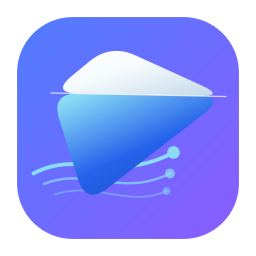
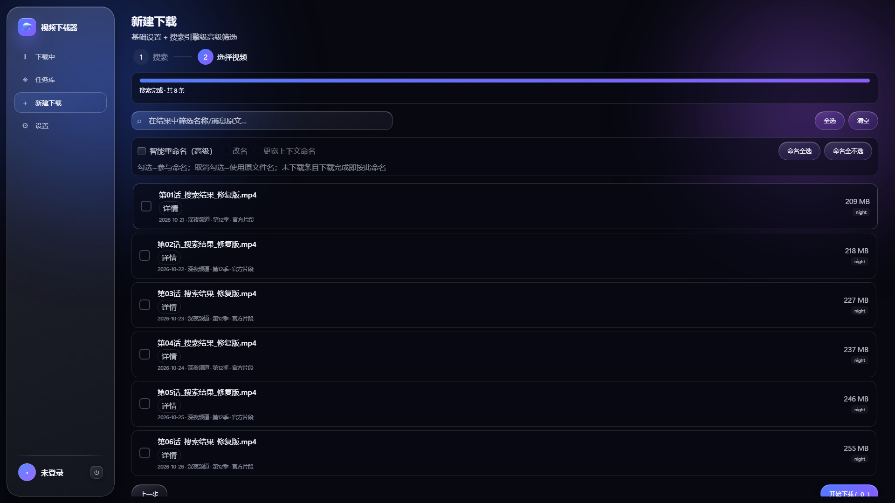
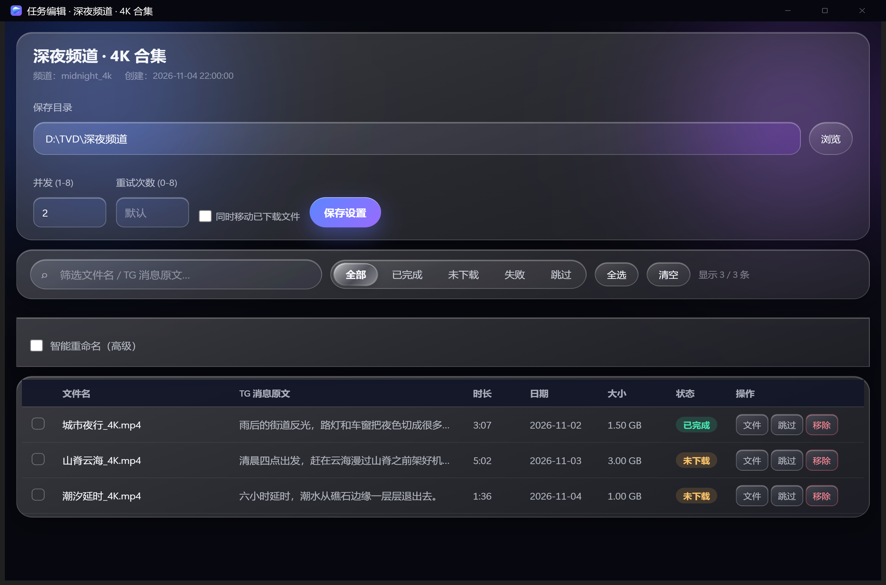
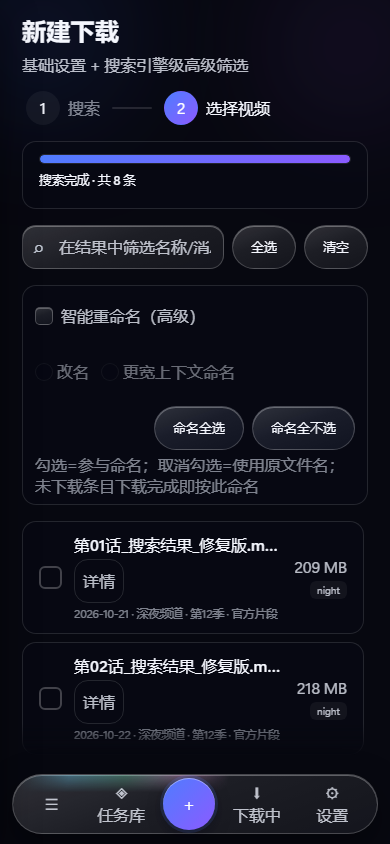
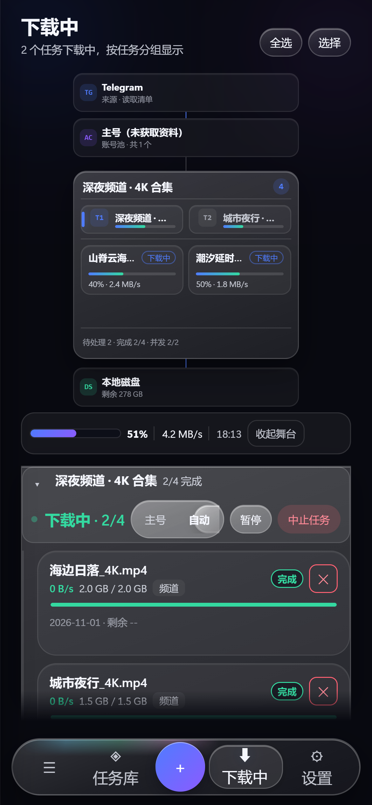
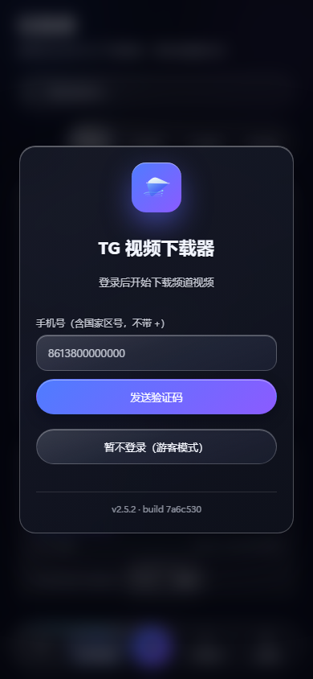
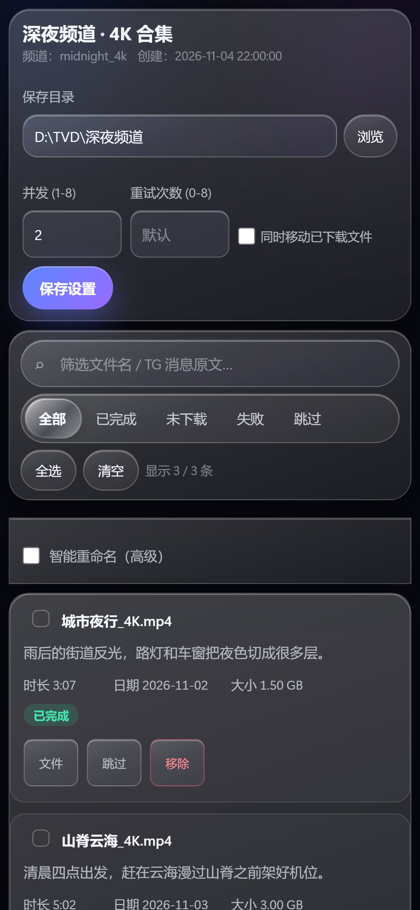

<div align="center">



# TG 视频下载器

### 把 Telegram 频道视频，整理成你自己的本地媒体库。

批量搜索、筛选、下载、续传和命名，一套界面完成。<br>
Windows 原生桌面、浏览器 / NAS 与命令行，使用同一套任务数据。

[](https://github.com/xmiqz/tg-video-downloader/releases/latest)
[](https://github.com/xmiqz/tg-video-downloader/stargazers)
[](LICENSE)<br>


**[下载](https://github.com/xmiqz/tg-video-downloader/releases/latest)** · **[快速开始](#快速开始)** · **[Docker 部署](#docker--nas)** · **[常见问题](#常见问题)**

<br>


</div>

<br>

## 它解决什么问题

Telegram 频道的视频通常散落在消息、相册和转发内容里。临时下载一两条不难；真正麻烦的是从一个频道里找出想要的内容、排好队列、处理失败、重启后续传，并把文件按可读的名字放好。

TG 视频下载器把这些步骤放进同一个任务：

- **先找到再下载**：频道内搜索、关键词匹配、日期 / 体积筛选、评论区和引用文本命中。
- **下载过程看得见**：每条视频的状态、速度、进度、并发槽位和总体剩余时间实时更新。
- **中断不会从头再来**：任务保存到本地，重启后继续；失败条目可以单独重试。
- **下载完成就能播放**：MP4 自动把 `moov` 移到文件开头，不必等完整文件加载。
- **一个任务库，多个入口**：Windows 桌面、浏览器 / Docker 和命令行共享同一套数据目录。

## 功能

| | |
| :-- | :-- |
| **频道批量扫描** | 输入频道名或 `t.me` 链接，按关键词与条件筛选后勾选视频。支持超过 1 GB 的大文件。 |
| **高级筛选** | 精确短语、全部词、任一词、模糊匹配、正则；体积上下限、日期范围、频道 / 评论区范围、排序与结果上限。 |
| **多路并发** | 1–8 路任务并发；单视频内部按 8 MB 分片并行下载。 |
| **断点续传** | 关机、关窗口或网络中断后继续未完成任务，已完成分片不重下。 |
| **失败可恢复** | 按错误类型自动重试，FloodWait 倒计时，单条失败可重试或移除。 |
| **智能重命名** | 从搜索命中句生成可读文件名，下载完成即命名；编辑页可预览、批量应用或还原原名。 |
| **任务整理** | 暂停 / 继续、任务折叠、编辑保存目录、追加视频、导入导出任务元数据。 |
| **每日壁纸** | Bing 每日一图缓存到本地；可保存历史、选择旧图或上传自己的背景。 |
| **多账号** | 主号与小号统一管理，任务可选择主号、小号或自动调度。 |
| **桌面与 Web** | Windows 原生 WebView2 界面；Linux / NAS 通过浏览器访问同一套 UI。 |

## 界面

### 桌面端

<table>
<tr>
<td width="50%"></td>
<td width="50%"></td>
</tr>
<tr>
<td width="50%"></td>
<td width="50%"></td>
</tr>
<tr>
<td width="50%"></td>
<td width="50%"></td>
</tr>
</table>

<p align="center">

</p>

### 移动端

同一套界面会在窄屏自动切换为底部导航，下载、任务库、设置和编辑功能保持一致。

<table>
<tr>
<td width="25%"></td>
<td width="25%"></td>
<td width="25%"></td>
<td width="25%"></td>
</tr>
<tr>
<td width="25%"></td>
<td width="25%"></td>
<td width="25%"></td>
</tr>
</table>

## 快速开始

### 1 · 下载

到 **[Releases](https://github.com/xmiqz/tg-video-downloader/releases/latest)** 选择对应平台。GitHub 资产名使用英文，中文说明见文件标签。

| 平台 | 文件 | 形态 |
| :-- | :-- | :-- |
| Windows x64 | `TGVideoDownloader.exe` | 图形界面 |
| Windows x64 | `TGVideoDownloader_TUI.exe` | 终端界面 |
| Windows ARM64 | `TGVideoDownloader_ARM64.exe` | 图形界面 |
| Windows ARM64 | `TGVideoDownloader_TUI_ARM64.exe` | 终端界面 |
| Linux x64 / ARM64 | `TGVideoDownloader_linux_*` | 命令行 |
| macOS Intel / Apple Silicon | `TGVideoDownloader_mac_*` | 命令行，附 `.command` 启动器 |
| Docker | `ghcr.io/xmiqz/tg-video-downloader` | 浏览器界面，amd64 / arm64 |

Windows 图形界面需要 WebView2 Runtime；Windows 11 已预装，Windows 10 多数设备已随更新安装。程序未做代码签名，SmartScreen 可能提示“未知发布者”。

### 2 · 登录 Telegram

首次启动输入包含国家区号的手机号，例如 `8613800000000`，不要带 `+`。验证码会发送到已登录的 Telegram App；如果账号启用了两步验证，再输入两步密码。

程序内置 Telegram 公开客户端凭证，通常无需自己申请。若内置凭证不可用，可按提示到 [my.telegram.org/apps](https://my.telegram.org/apps) 创建自己的 `api_id` / `api_hash`。

### 3 · 新建下载

进入 **新建下载**，输入频道用户名或链接，设置关键词、数量与筛选条件。预览结果后勾选需要的视频，设置保存目录与并发数，开始下载。

下载中的任务会出现在 **下载中**：可以查看总体进度、每条视频速度、剩余时间、并发槽位，也可以暂停、重试、取消或打开已完成文件。

### 4 · 数据保存在哪里

桌面与命令行版本默认在程序同级的 `TG视频下载器数据/` 中保存：

```text
TG视频下载器数据/
├── tg_config.json       # 下载目录、外观、账号偏好
├── auth.json            # Web 管理员密码哈希
├── tg_session.session   # Telegram 登录会话
├── tasks/               # 任务清单与断点信息
└── downloads/           # 默认下载目录
```

把整个目录随程序一起迁移，就能保留任务、设置和登录状态。`.session` 等同于登录凭证，不要分享给他人。

## Docker / NAS

镜像地址：

```text
ghcr.io/xmiqz/tg-video-downloader:v2.5.1
```

在 Docker 主机或 NAS 上使用仓库中的 [compose.yaml](./compose.yaml)：

```bash
docker compose up -d
docker compose ps
docker compose logs -f --tail=100
```

首次启动读取一次性初始化令牌：

```bash
docker compose exec tg-video-downloader cat /data/.setup-token
```

浏览器打开 `http://主机地址:8787`，输入令牌并设置管理员密码。该密码只保护 Web 管理界面，不是 Telegram 两步验证密码；设置成功后令牌文件会自动删除。

容器默认使用命名卷 `tg-video-downloader-data`，以 uid/gid `10001:10001` 运行，并启用只读根文件系统、`cap_drop: ALL` 与 `no-new-privileges`。如需绑定到宿主机目录，请先把目录授权给 `10001:10001`，再修改 [compose.yaml](./compose.yaml) 中的卷映射。

> 内置 HTTP 不提供 TLS。仅在本机或可信局域网直接使用 HTTP；跨网络访问时请置于 HTTPS 反向代理之后，并设置 `TGDL_COOKIE_SECURE=1`。

备份、升级与回滚：[docs/nas-backup-restore.md](./docs/nas-backup-restore.md)
反向代理示例：[docs/nas-reverse-proxy.md](./docs/nas-reverse-proxy.md)

### 常用环境变量

| 变量 | 默认值 | 说明 |
| :-- | :-- | :-- |
| `TGDL_DATA_DIR` | 桌面为程序同级数据目录，容器为 `/data` | 数据目录 |
| `TGDL_HOST` | `127.0.0.1` | 监听地址；远程访问设为 `0.0.0.0` |
| `TGDL_PORT` | `8787` | 服务端口 |
| `TGDL_ALLOWED_ROOTS` | 数据目录 | 允许写入的下载根目录 |
| `TGDL_COOKIE_SECURE` | `0` | HTTPS 反向代理后设为 `1` |
| `TGDL_TRUST_PROXY` | `0` | 可信反向代理后设为 `1` |
| `PUID` / `PGID` | `10001` | 容器运行用户 |

配置优先级：命令行参数 > `TGDL_*` 环境变量 > `tg_config.json` / `server.json` > 默认值。

## 命令行

不带参数运行进入交互菜单：

```bash
python tg_video_dl.py
```

也可以直接指定频道和数量：

```bash
python tg_video_dl.py @频道名 20 50 "4K,预告片" 2
```

下载中常用快捷键：

| 按键 | 功能 |
| :-- | :-- |
| `I` | 简洁 / 详细视图 |
| `P` | 暂停当前视频并释放槽位 |
| `R` | 恢复一个暂停的视频 |
| `S` | 跳过当前视频 |
| `X` | 从任务移除，保留已下载文件 |
| `Q` | 中止全部下载，可在任务中继续 |

## 从源码运行

需要 Python 3.10+。

命令行：

```bash
python -m pip install telethon
python tg_video_dl.py
```

Windows 图形界面：

```bash
python -m pip install -r requirements-server.txt Pillow
python gui.py
```

浏览器 / Docker 版：

```bash
python -m pip install -r requirements-server.txt
python -m server_app --host 127.0.0.1 --port 8787 --data-dir ./data
```

## 自行打包

```bash
python -m pip install pyinstaller
python build.py [输出目录]
```

Windows 会生成 GUI 与 TUI；Linux / macOS 生成命令行程序，macOS 另附 `.command` 启动器。PyInstaller 不支持交叉编译，每个平台需在对应系统构建。

GitHub Actions 会构建 Windows x64 / ARM64、Linux x64 / ARM64、macOS Intel / Apple Silicon，并推送 GHCR 多架构镜像。构建号统一使用提交短 SHA。

## 常见问题

**收不到验证码？**
验证码由 Telegram 发送到已登录的 App，不是短信。确认 App 能接收 Telegram 服务消息，并使用最新一条验证码。

**Windows 提示未知发布者？**
程序未购买代码签名证书。点击“更多信息” → “仍要运行”。这不改变程序功能。

**Linux 提示权限不足？**
执行 `chmod +x TGVideoDownloader_linux_x64` 后再运行。

**下载完成后文件在哪？**
默认在 `TG视频下载器数据/downloads/`，按频道名建立子目录；可在设置或任务编辑页修改。

**换电脑怎么迁移？**
关闭程序，把整个 `TG视频下载器数据/` 目录随程序复制到新设备。任务路径若失效，启动时会自动重定位到新的下载根目录。

**浏览器版能打开服务器上的文件吗？**
浏览器不能直接打开服务器文件，已完成视频会通过同源链接在浏览器内播放或下载。桌面版可直接调用系统文件管理器。

## 隐私与安全

- 登录会话、配置、任务和下载内容都保存在本地数据目录，不上传到项目服务器。
- 网络通信由 Telethon 直接连接 Telegram 官方服务器，用于登录和下载。
- 程序不包含统计、广告或第三方数据上报。
- Web / Docker 版使用管理员密码和会话 Cookie；首次设置需要 `/data/.setup-token`。
- `.session`、`auth.json` 和 `.setup-token` 都属于敏感文件，不要提交到仓库或分享给他人。

## 从源码构建与回归

本项目的测试分为三层：

- `python -m pytest -q`：后端与桌面壳契约。
- `node --test "tests/js/*.test.mjs"`：前端纯逻辑、结构与降级断言。
- 真实打包程序的浏览器级 smoke：以隔离数据目录启动，验证登录、任务库、编辑、导入导出与每日壁纸。

前端不依赖框架、构建链或外部 CDN；所有资源随包分发。

## 合规

本工具仅用于下载你有权访问的内容。请遵守当地法律法规与 [Telegram 服务条款](https://telegram.org/tos)，自行承担使用责任。

## License

[MIT License](LICENSE)，Copyright (c) 2026 xmiqz

## 致谢

- [Telethon](https://github.com/LonamiWebs/Telethon)：asyncio MTProto 客户端
- [FastAPI](https://fastapi.tiangolo.com/) / [Uvicorn](https://www.uvicorn.org/)：浏览器服务
- [Microsoft Edge WebView2](https://developer.microsoft.com/microsoft-edge/webview2/)：Windows 原生界面
