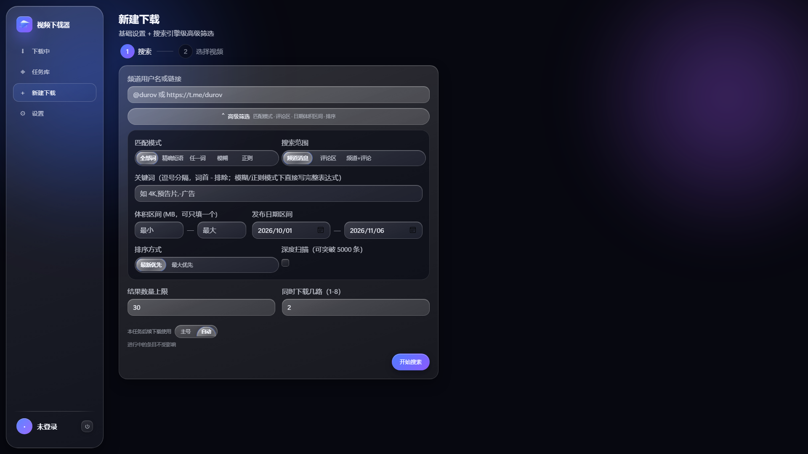
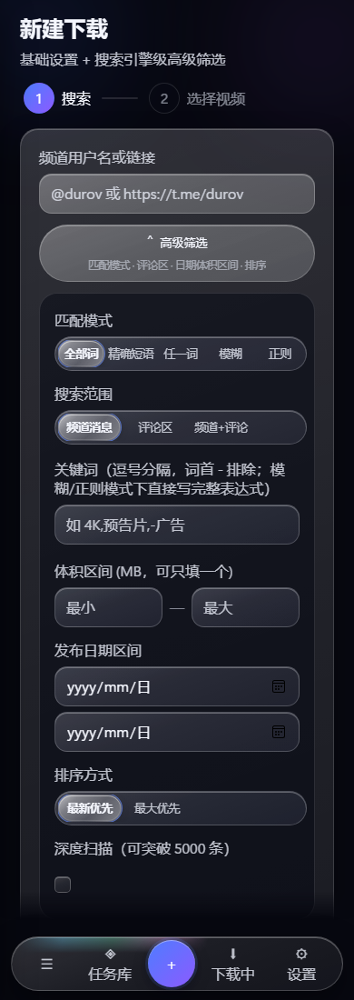
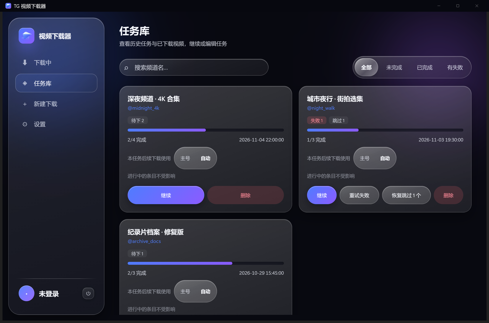
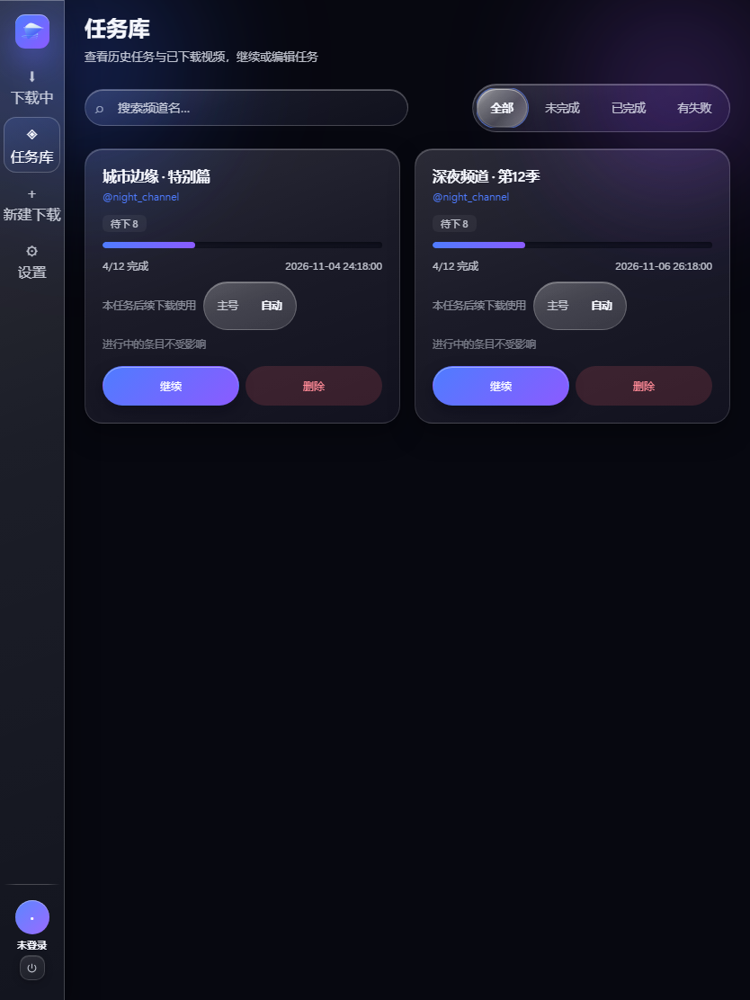
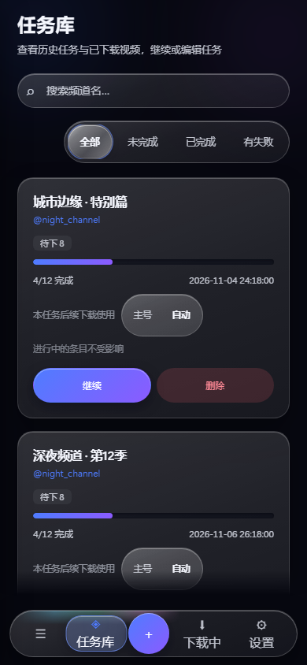
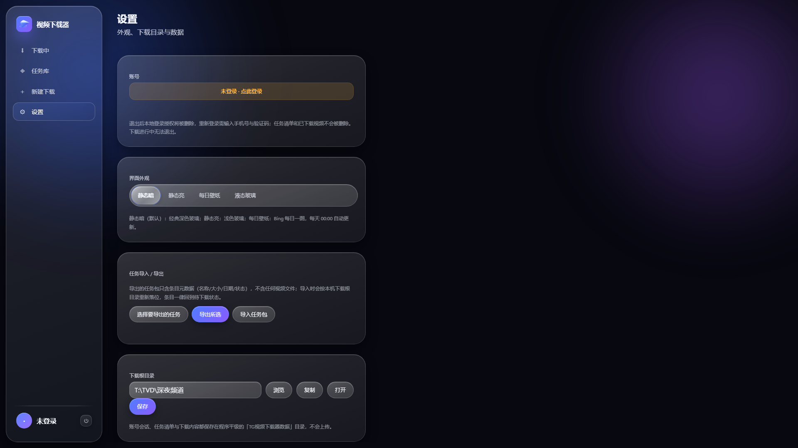
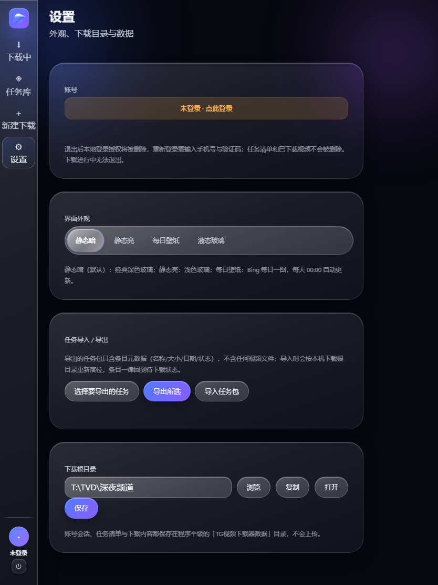

# 使用说明

本文覆盖桌面版（Windows 图形界面）、浏览器版（Linux / Docker / NAS）与命令行 / TUI 的日常使用。文档引用 `docs/images/` 中的正式发布截图；外观截图为已确认采用的 v2.5.1 Windows 桌面版真实运行画面，其他界面截图来自隔离演示数据，均保留原始来源与版本说明。

> 截图中为未登录状态的界面，任务列表为空。登录 Telegram 后即可创建下载任务。

---

## 1. 启动与登录

### 1.1 桌面版（Windows）

双击 `TGVideoDownloader.exe` 启动图形界面。首次启动会在程序所在目录生成 `TG视频下载器数据/`。

登录流程：

1. 在「设置」页点击「点此登录」，弹出登录框；
2. 输入手机号，**带国家区号、不带 `+`**（例如 `8613800000000`）；
3. 在 Telegram App 内查看验证码并填入；
4. 若账号开启两步验证，再输入两步验证密码。


登录成功后，左下角会显示当前账号，设置页的「账号」区域同样显示账号信息。侧栏底部是账号区，旁边的电源图标用于退出登录。

### 1.2 浏览器版（NAS / Docker / Linux）

1. 终端或 NAS 的 Docker 管理器启动容器后，浏览器打开 `http://NAS地址:8787`；
2. 首次访问需要初始化令牌：`docker compose exec tg-video-downloader cat /data/.setup-token`；
3. 输入令牌、设置管理员密码（只保护 Web 界面，与 Telegram 两步验证无关）；
4. 进入界面后，在「设置」页登录 Telegram，步骤与桌面版一致。

已初始化过的实例再次打开时，会直接出现管理员登录页，输入密码后进入主界面。浏览器版登录后，设置页底部会多出「Web 服务 → 退出 Web 服务登录」，它只结束浏览器管理员会话，Telegram 登录与下载任务不受影响。

---

## 2. 界面布局与操作路径

同一套界面按窗口宽度自动切换三种形态，切换不需要刷新，也不影响正在进行的下载：

| 布局 | 触发宽度 | 导航形态 | 账号入口 |
| --- | --- | --- | --- |
| 桌面 | ≥1024px | 左侧常驻侧栏：下载中 / 任务库 / 新建下载 / 设置 | 侧栏底部账号区 |
| 平板 | 640–1023px | 左侧图标窄栏，图标下方保留短标签 | 窄栏底部账号区 |
| 手机 | <640px | 底部悬浮胶囊栏：`☰`、任务库、中央 `＋`、下载中、设置 | `☰` 抽屉底部 |

### 2.1 桌面（侧栏）

- 左侧栏点「新建下载」→ 填频道 → 开始搜索 → 勾选结果 → 开始下载。
- 「任务库」按状态筛选（全部 / 未完成 / 已完成 / 有失败），右侧搜索框按任务名过滤。
- 「下载中」是实时面板；「设置」里可改外观、下载目录与任务导入导出。
- 侧栏底部的账号区点击即打开登录弹层；旁边的电源图标是退出登录。

### 2.2 平板（窄栏）

宽度在 640–1023px 之间时，侧栏收成图标窄栏，四个入口与桌面一致，只是文字标签更短。操作路径不变：点图标进页，页内布局改为单列，表单和列表会自动换行。

### 2.3 手机（底栏 + 抽屉）

- 底栏五个位置：`☰` 打开抽屉、任务库、中央 `＋`（新建下载）、下载中、设置。
- 抽屉里是完整导航，并带账号区与退出登录按钮。
- 新建下载的三步（搜索 → 勾选 → 下载）在手机上同样成立，只是结果列表改为单列卡片。

> 手机上浏览器地址栏会占去一部分高度，建议横屏用于批量勾选，竖屏用于单个任务管理。

---

## 3. 新建下载任务

### 3.1 填写频道与搜索条件

进入「新建下载」页，流程固定为三步：**搜索 → 勾选 → 下载**。

- **频道**：可直接填 `@durov`，也可粘贴 `https://t.me/durov` 形式的链接。
- **关键词**：留空表示不按关键词过滤，直接扫描频道视频。
- **匹配模式**（展开「高级筛选」后可见）：精确短语 / 全部词 / 任一词 / 模糊匹配 / 正则表达式。
- **结果上限**：本次最多取多少条搜索结果。
- **体积上下限**：单位 MB，用于过滤过小或过大的文件。
- **日期范围**：只保留该时间段内发布的视频。
- **搜索范围**：仅频道正文 / 仅评论区 / 两者都搜。
- **排序**：按日期或按体积。
- **同时下载几路**：1–8，决定并发下载数；「本任务后续下载使用」可选择主号 / 自动。

桌面：



手机（导航落到底部）：



### 3.2 预览与勾选

搜索完成后会列出匹配的视频（标题、时长、体积、日期）。默认全选，可逐条取消。确认后开始下载。

> 搜索走的是 Telegram 自己的服务端搜索，与在 Telegram App 内搜索同一机制。频道索引状态会影响结果，很久以前的消息可能搜不到。

---

## 4. 任务库与任务编辑

「任务库」列出全部任务，标注状态（等待 / 下载中 / 已完成 / 有失败项）与进度。顶部可按状态切换，右侧搜索框按任务名过滤。







对单个任务可以：

- **继续**：从未完成的条目接着下（断点续传，已下分片不重下）
- **仅重试失败**：只处理失败的条目
- **编辑**：改任务名、并行路数、保存目录（可选把已下载文件一起搬移）
- **条目管理**：把某条标记为待下载 / 跳过 / 移除
- **追加视频**：按新条件再搜一批，自动去重后并入当前任务
- **删除**：移除任务记录（可选择是否一并删除已下载文件）

### 4.1 任务导入 / 导出

设置页的「任务导入 / 导出」用于搬移任务清单：

1. 点「选择要导出的任务」，勾选需要的任务；
2. 点「导出所选」，得到一份只含条目元数据（名称 / 大小 / 日期 / 状态）的 JSON，**不含任何视频文件**；
3. 在另一台机器的设置页点「导入任务包」，选择该 JSON。

导入后条目一律回到「待下载」，并按本机下载根目录重新落位；视频文件需要自行拷贝。这个功能适合换机、备份任务清单，或在多个实例之间同步计划。

---

## 5. 下载中

「下载中」页是实时面板，展示所有正在进行的任务、当前速度、剩余时间与整体进度。右侧提示「勾选卡片可批量操作」。


可对单个条目或批量执行：暂停 / 恢复 / 跳过 / 移除。暂停会释放并发槽位，队列中下一个立刻开始；跳过会清理该条目的临时分片。

> 该页面只消费后端推送的下载事件，不额外轮询，因此长时间挂着也不会明显增加负载。

---

## 6. 设置






设置页按卡片组织：账号、界面外观、任务导入 / 导出、下载根目录，浏览器版另有 Web 服务。

### 6.1 账号

未登录时显示「未登录 · 点此登录」，点击进入登录弹层。登录后显示账号信息，并提供退出登录；退出会删除本地登录授权，但不会删除任务清单和已下载的视频，下载进行中无法退出。

### 6.2 界面外观

四档主题，选择后立即生效并记住：

- **静态暗**（默认）：经典深色玻璃，适合长时间挂机。
- **静态亮**：浅色玻璃，白天或亮环境更省眼。
- **每日壁纸**：Bing 每日一图作背景，每天 00:00 自动更新。选中后展开壁纸面板：
  - 「立即同步」立刻拉取当天图片；
  - 「上传背景」用本地图片替换；
  - 「保存历史壁纸」后，之前用过的图会保留，可在「已保存的壁纸」里随时切回。
- **液态玻璃**：实时采样窗口正后方的真实画面做磨砂，仅 Windows 桌面版提供；浏览器版不显示这一项。

壁纸层保持原图清晰，可读性由卡面的磨砂底与墨色承担；虚拟机、远程桌面等环境下液态玻璃可能自动降级为静态实色。

### 6.3 下载根目录

默认在数据目录的 `downloads/` 下，按频道名建子目录。可以直接输入路径，也可以用「选择文件夹」；桌面版自带文件夹选择框。浏览器版可写入的路径受 `TGDL_ALLOWED_ROOTS` 白名单限制，输入框下方会提示允许范围。

> 账号会话、任务清单与下载内容都保存在程序平级的「TG视频下载器数据」目录，不会上传。

### 6.4 减少动态效果

如果系统开启了「减少动画」（Windows 辅助功能 → 视觉效果，或浏览器 / 系统的 `prefers-reduced-motion`），程序会自动：

- 把所有动效时长归零、缓动改为线性
- 视图切换改为直切
- 保留状态色、进度条与文字提示

如需手动验证：浏览器版在系统开启该选项后刷新页面，动画即不再播放。

---

## 7. 命令行 / TUI

不带参数运行进入交互菜单：

```bash
python tg_video_dl.py
```

带参数直接下载：

```bash
python tg_video_dl.py @频道名 数量 [最小MB] [关键词] [并发数] [all]
python tg_video_dl.py @somechan 20 50 "4K,预告片" 2
```

末尾加 `all` 跳过交互勾选，直接下载全部搜索结果。

下载中快捷键：

| 按键 | 功能 |
| --- | --- |
| `I` | 切换简洁 / 详细显示 |
| `P` | 暂停当前视频（释放槽位） |
| `R` | 恢复一个暂停的视频 |
| `S` | 跳过当前视频（清理临时文件） |
| `X` | 从任务移除当前视频（保留已下载文件） |
| `Q` | 中止全部下载 |

---

## 8. 常见操作

**只想重下失败的几条**：任务库 → 该任务 → 「仅重试失败」。

**想改保存位置**：任务库 → 编辑 → 修改保存目录；勾选「搬移已下载文件」可把已完成文件一并移动。

**下载中断了怎么办**：直接重开程序 / 重启容器，在任务库点「继续」，已下分片不会重下。

**大任务太大**：单任务超过 999 条，或同时超过 300 条且总体积超过 300 GB 时会自动拆成多个任务，各自独立进度。

**换机器**：整个数据目录（桌面版为 `TG视频下载器数据/`，浏览器版为数据卷）拷贝过去即可，登录状态与任务清单一并带走；如果只想带走清单，用设置页的任务导出 / 导入。

---

## 9. 排查

| 现象 | 处理 |
| --- | --- |
| 收不到验证码 | 确认 Telegram App 已登录且能收消息；多次请求时用最新验证码 |
| Windows 提示未知发布者 | “更多信息 → 仍要运行”（未做代码签名） |
| Linux 提示权限不足 | `chmod +x TGVideoDownloader_linux_x64` |
| 浏览器版打不开 | 确认 `TGDL_HOST=0.0.0.0`、端口 8787 已放行、容器在运行 |
| 忘记管理员密码 | 删除数据目录下 `auth.json` 并重启，用新的 `.setup-token` 重设 |
| 下载目录不可写 | 浏览器版检查 `TGDL_ALLOWED_ROOTS` 与容器内 uid/gid 权限 |
| 玻璃主题发灰 / 实色 | 环境不支持 `backdrop-filter`，属预期降级 |
| 每日壁纸不更新 | 点「立即同步」手动拉取；离线环境请改用上传背景或静态主题 |

---

## 10. 截图规格与来源

以下截图是仓库正式发布素材，使用隔离演示数据；桌面图为 1920×1269，平板图为 768×1024，移动图为 390×844 CSS 视口、3× 像素比（1170×2532）。四种外观截图为已确认采用的 v2.5.1 Windows 桌面版真实运行画面；其余截图来自 v2.5.2 发布用的打包程序与隔离 mock 数据。公开图片不包含个人目录、账号凭据或真实聊天数据，目录选择截图已做路径脱敏。

| 文件 | 像素尺寸 | 来源页面 | 布局 |
| --- | --- | --- | --- |
| `hero-dashboard.png` | 1920×1269 | 下载中 | 桌面 |
| `task-library.png` | 1920×1269 | 任务库 | 桌面 |
| `new-download.png` | 1920×1269 | 新建下载（高级筛选展开） | 桌面 |
| `new-download-results.png` | 1920×1269 | 筛选结果 | 桌面 |
| `task-edit.png` | 1920×1269 | 任务编辑 | 桌面 |
| `task-edit-folder.png` | 1920×1269 | 编辑任务 · 目录选择（路径已脱敏） | 桌面 |
| `settings.png` | 1920×1269 | 设置 | 桌面 |
| `tablet/tasks.png` | 768×1024 | 任务库 | 平板 |
| `tablet/settings.png` | 768×1024 | 设置 | 平板 |
| `mobile/hero-dashboard.png` | 1170×2532 | 下载中 | 手机 |
| `mobile/task-library.png` | 1170×2532 | 任务库 | 手机 |
| `mobile/new-download.png` | 1170×2532 | 新建下载（高级筛选展开） | 手机 |
| `mobile/new-download-results.png` | 1170×2532 | 筛选结果 | 手机 |
| `mobile/task-edit.png` | 1170×2532 | 任务编辑 | 手机 |
| `mobile/task-edit-folder.png` | 1170×2532 | 编辑任务 · 目录选择（路径已脱敏） | 手机 |
| `mobile/settings.png` | 1170×2532 | 设置 | 手机 |
| `login.png` | 1920×1269 | 登录弹层 | 桌面 |
| `theme-dark.png` / `theme-light.png` / `theme-bing.png` / `theme-liquid.png` | v2.5.1 实机截图 | 四种外观 | Windows 桌面 |
| `widths/1280-active.png` / `widths/834-active.png` / `widths/390-active.png` | 响应式宽度矩阵 | 下载中 | 桌面 / 平板 / 手机 |
