# 使用说明

本文覆盖桌面版（Windows 图形界面）、浏览器版（Linux / Docker / NAS）与命令行 / TUI 的日常使用。截图来自实际运行画面，按桌面、平板、手机三种布局分别标注。

> 截图中为未登录状态的界面，任务列表为空。登录 Telegram 后即可创建下载任务。

---

## 1. 启动与登录

### 1.1 桌面版（Windows）

双击 `TGVideoDownloader.exe` 启动图形界面。首次启动会在程序所在目录生成 `TG视频下载器数据/`。

登录流程：

1. 在「设置」页点击「点此登录」，弹出登录框；
2. 输入手机号，**带国家区号、不带 `+`**（例如 `8613800000000`）；
3. 在 Telegram App 内查看验证码并填入；
4. 若账号开启两步验证，再输入两步验证密码。

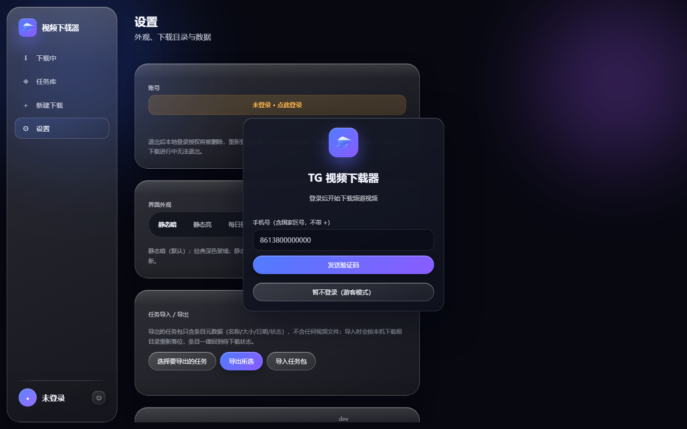

登录弹层带入场动效（淡入 + 轻微缩放上移，约 0.5 秒）：

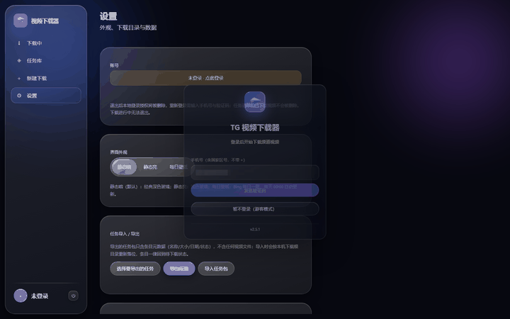

登录成功后，左下角会显示当前账号，设置页的「账号」区域同样显示账号信息。

### 1.2 浏览器版（NAS / Docker / Linux）

1. 终端或 NAS 的 Docker 管理器启动容器后，浏览器打开 `http://NAS地址:8787`；
2. 首次访问需要初始化令牌：`docker compose exec tg-video-downloader cat /data/.setup-token`；
3. 输入令牌、设置管理员密码（只保护 Web 界面，与 Telegram 两步验证无关）；
4. 进入界面后，在「设置」页登录 Telegram，步骤与桌面版一致。

已初始化过的实例再次打开时，会直接出现管理员登录页，输入密码后进入主界面。

---

## 2. 新建下载任务

### 2.1 填写频道与搜索条件

进入「新建下载」页，流程固定为三步：**搜索 → 勾选 → 下载**。

- **频道**：可直接填 `@durov`，也可粘贴 `https://t.me/durov` 形式的链接。
- **关键词**：留空表示不按关键词过滤，直接扫描频道视频。
- **匹配模式**：精确短语 / 全部词 / 任一词 / 模糊匹配 / 正则表达式。
- **结果上限**：本次最多取多少条搜索结果。
- **体积上下限**：单位 MB，用于过滤过小或过大的文件。
- **日期范围**：只保留该时间段内发布的视频。
- **搜索范围**：仅频道正文 / 仅评论区 / 两者都搜。
- **排序**：按日期或按体积。
- **同时下载几路**：1–8，决定并发下载数。

桌面（1440 宽）：

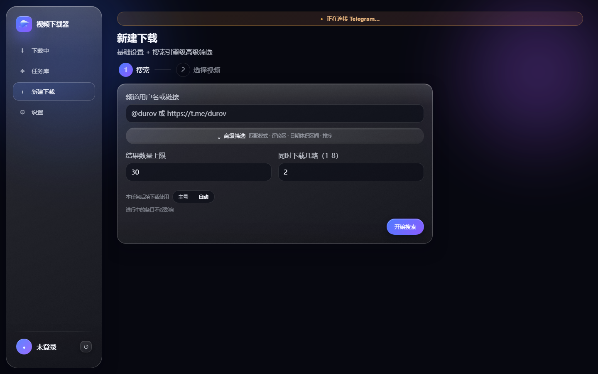

平板（768 宽，左侧变为窄栏图标导航）：

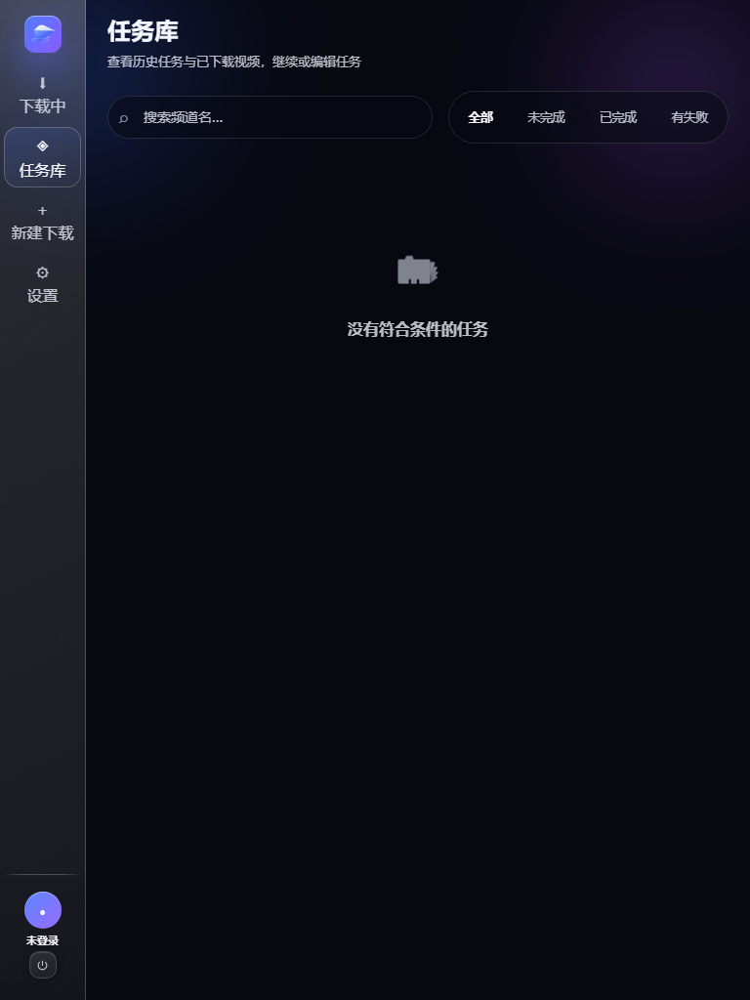

手机（390 宽，导航落到底部）：

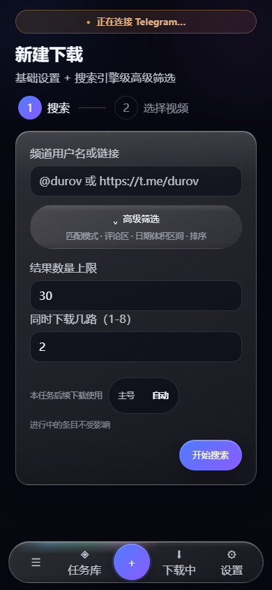

### 2.2 预览与勾选

搜索完成后会列出匹配的视频（标题、时长、体积、日期）。默认全选，可逐条取消。确认后开始下载。

> 搜索走的是 Telegram 自己的服务端搜索，与在 Telegram App 内搜索同一机制。频道索引状态会影响结果，很久以前的消息可能搜不到。

---

## 3. 任务库与任务编辑

「任务库」列出全部任务，标注状态（等待 / 下载中 / 已完成 / 有失败项）与进度。

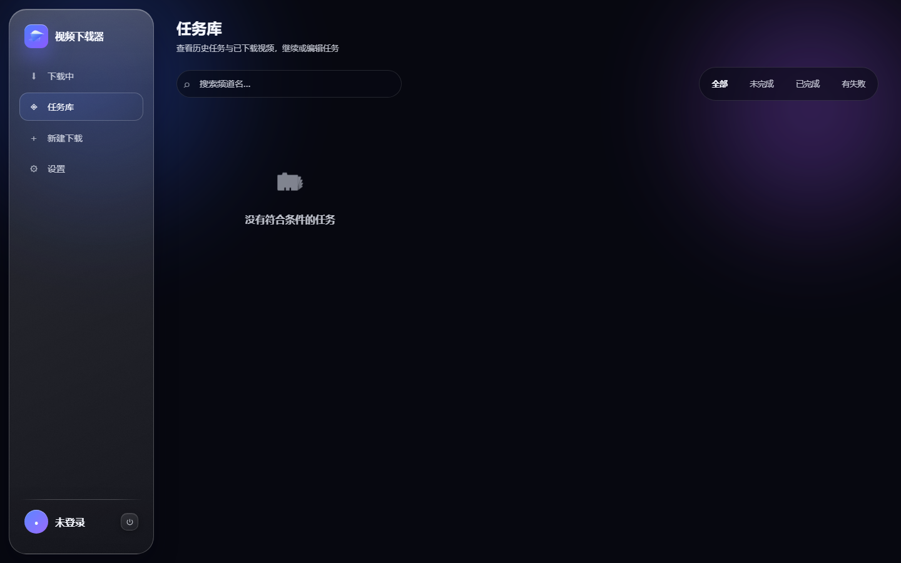


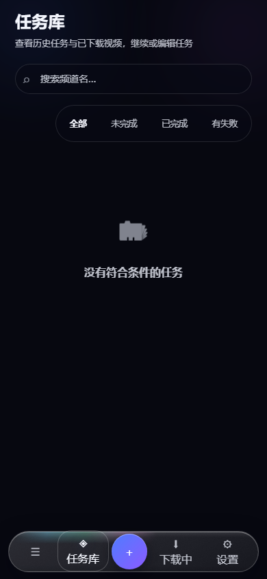

对单个任务可以：

- **继续**：从未完成的条目接着下（断点续传，已下分片不重下）
- **仅重试失败**：只处理失败的条目
- **编辑**：改任务名、并行路数、保存目录（可选把已下载文件一起搬移）
- **条目管理**：把某条标记为待下载 / 跳过 / 移除
- **追加视频**：按新条件再搜一批，自动去重后并入当前任务
- **删除**：移除任务记录（可选择是否一并删除已下载文件）

---

## 4. 下载中

「下载中」页是实时面板，展示所有正在进行的任务、当前速度、剩余时间与整体进度。

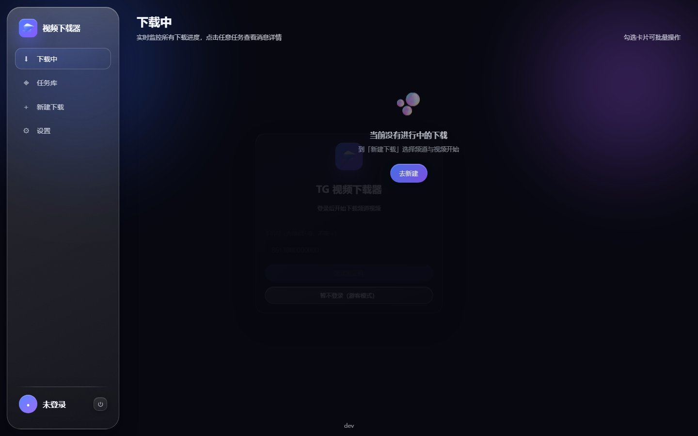

可对单个条目或批量执行：暂停 / 恢复 / 跳过 / 移除。暂停会释放并发槽位，队列中下一个立刻开始；跳过会清理该条目的临时分片。

> 该页面只消费后端推送的下载事件，不额外轮询，因此长时间挂着也不会明显增加负载。

---

## 5. 设置

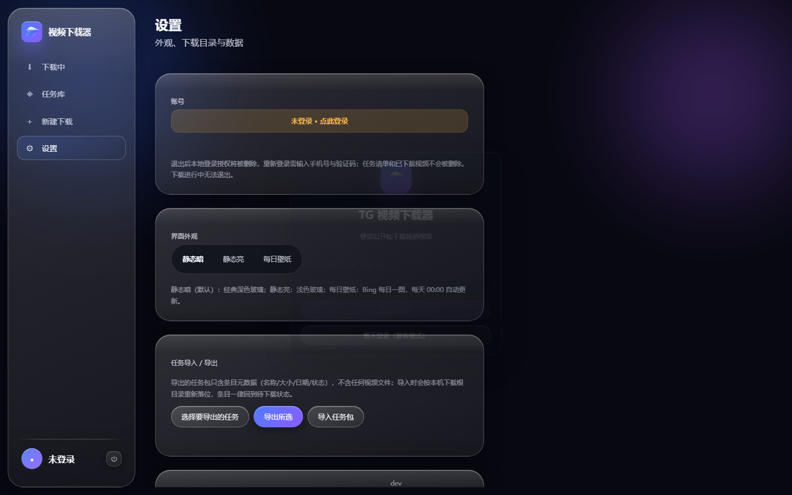

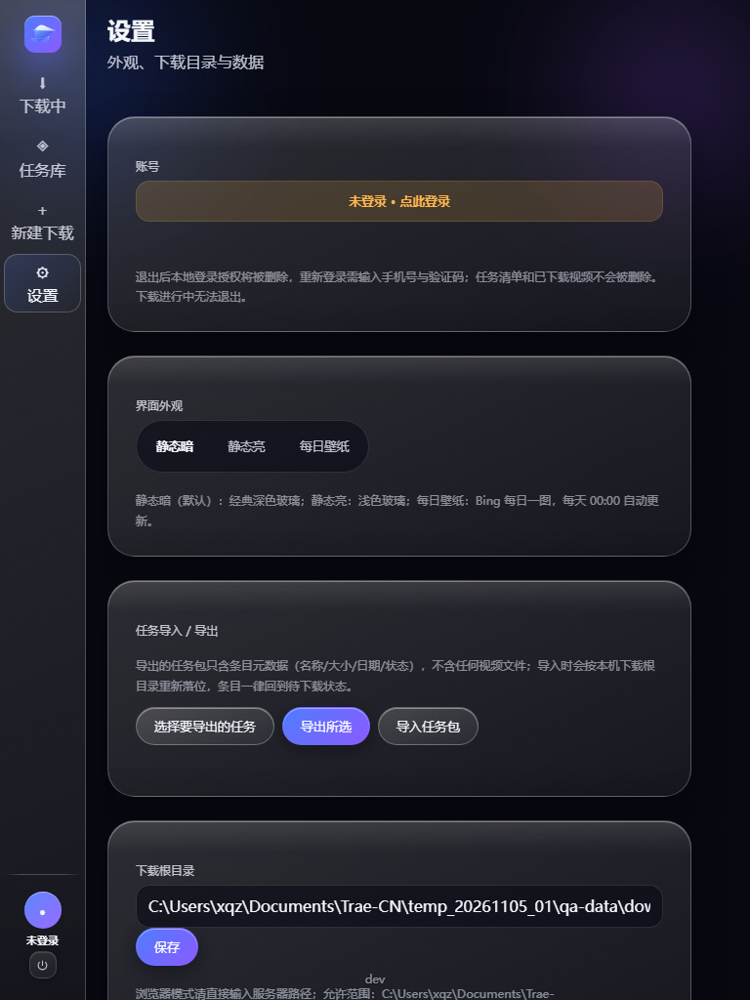

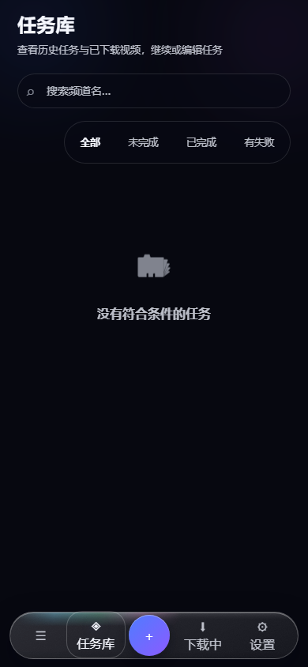

设置页包含：

- **外观**：静态暗（默认）、静态亮、液态玻璃。选择会立即生效并记住。
  液态玻璃会实时采样窗口后方画面做磨砂，虚拟机、远程桌面等环境下可能自动降级为静态实色。
- **下载目录**：默认在数据目录的 `downloads/` 下，按频道名建子目录。桌面版自带文件夹选择框。
  浏览器版可写入的路径受 `TGDL_ALLOWED_ROOTS` 白名单限制。
- **账号**：显示登录状态，提供登录 / 退出登录。
- **数据**：数据目录位置与占用说明。

### 减少动态效果

如果系统开启了「减少动画」（Windows 辅助功能 → 视觉效果，或浏览器 / 系统的 `prefers-reduced-motion`），程序会自动：

- 把所有动效时长归零、缓动改为线性
- 视图切换改为直切
- 保留状态色、进度条与文字提示

如需手动验证：浏览器版在系统开启该选项后刷新页面，动画即不再播放。

---

## 6. 命令行 / TUI

不带参数运行进入交互菜单：

```bash
python tg_video_dl.py
```

带参数直接下载：

```bash
python tg_video_dl.py @频道名 数量 [最小MB] [关键词] [并发数] [all]
python tg_video_dl.py @somechan 20 50 "4K,预告片" 2
```

末尾加 `all` 跳过交互勾选，直接下载全部搜索结果。

下载中快捷键：

| 按键 | 功能 |
| --- | --- |
| `I` | 切换简洁 / 详细显示 |
| `P` | 暂停当前视频（释放槽位） |
| `R` | 恢复一个暂停的视频 |
| `S` | 跳过当前视频（清理临时文件） |
| `X` | 从任务移除当前视频（保留已下载文件） |
| `Q` | 中止全部下载 |

---

## 7. 常见操作

**只想重下失败的几条**：任务库 → 该任务 → 「仅重试失败」。

**想改保存位置**：任务库 → 编辑 → 修改保存目录；勾选「搬移已下载文件」可把已完成文件一并移动。

**下载中断了怎么办**：直接重开程序 / 重启容器，在任务库点「继续」，已下分片不会重下。

**大任务太大**：单任务超过 999 条，或同时超过 300 条且总体积超过 300 GB 时会自动拆成多个任务，各自独立进度。

**换机器**：整个数据目录（桌面版为 `TG视频下载器数据/`，浏览器版为数据卷）拷贝过去即可，登录状态与任务清单一并带走。

---

## 8. 排查

| 现象 | 处理 |
| --- | --- |
| 收不到验证码 | 确认 Telegram App 已登录且能收消息；多次请求时用最新验证码 |
| Windows 提示未知发布者 | “更多信息 → 仍要运行”（未做代码签名） |
| Linux 提示权限不足 | `chmod +x TGVideoDownloader_linux_x64` |
| 浏览器版打不开 | 确认 `TGDL_HOST=0.0.0.0`、端口 8787 已放行、容器在运行 |
| 忘记管理员密码 | 删除数据目录下 `auth.json` 并重启，用新的 `.setup-token` 重设 |
| 下载目录不可写 | 浏览器版检查 `TGDL_ALLOWED_ROOTS` 与容器内 uid/gid 权限 |
| 玻璃主题发灰 / 实色 | 环境不支持 `backdrop-filter`，属预期降级 |

---

## 9. 截图来源说明

| 文件 | 来源 |
| --- | --- |
| `desktop-tasks.png` / `desktop-new.png` / `desktop-active.png` / `desktop-settings.png` | 浏览器版 1440×900 |
| `desktop-1920.png` | 浏览器版 1920×1080 |
| `tablet-*.png` | 浏览器版 768×1024 |
| `mobile-*.png` | 浏览器版 390×844 |
| `login.png` | 浏览器版 1440×900，登录弹层 |
| `login-enter.gif` | 登录弹层入场动效，实际运行画面逐帧录制 |

截图为同一版本的本地实例，Telegram 未登录，因此任务与下载中页面为空态。
