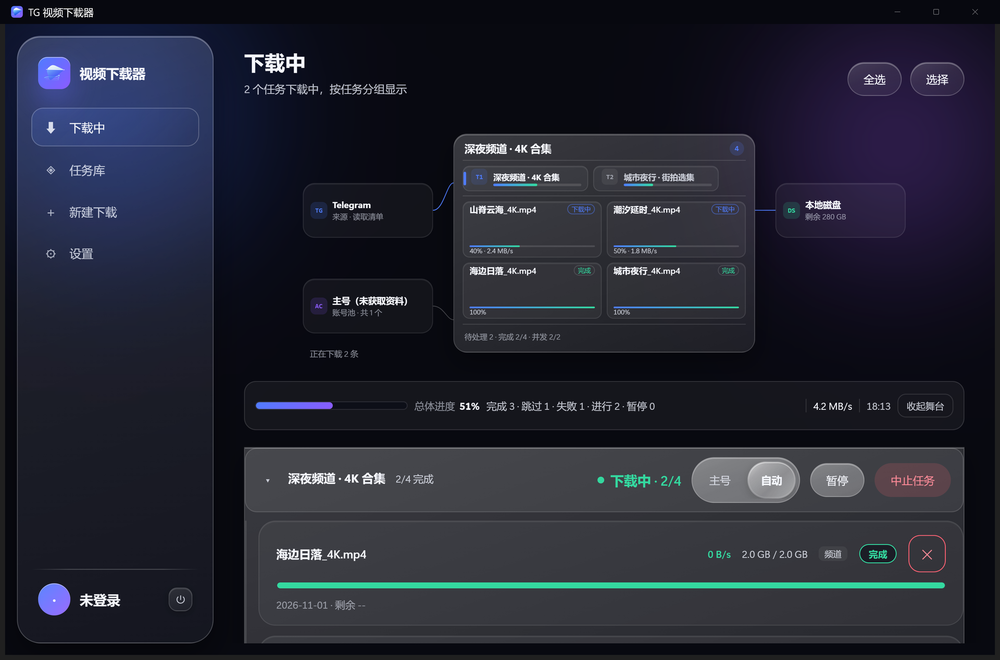
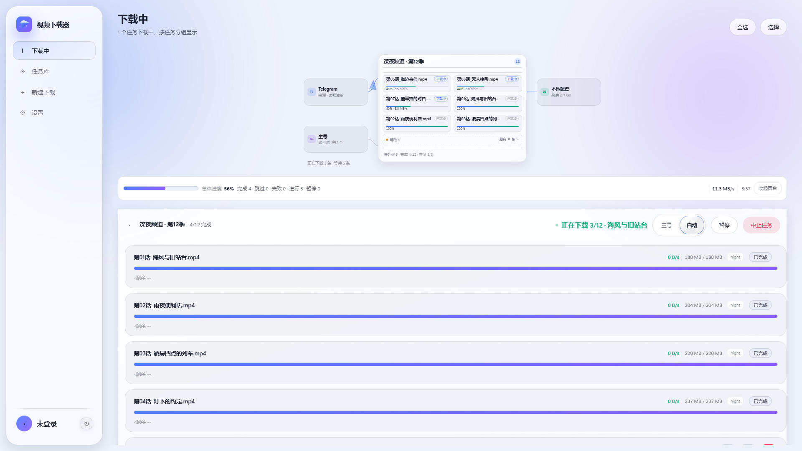
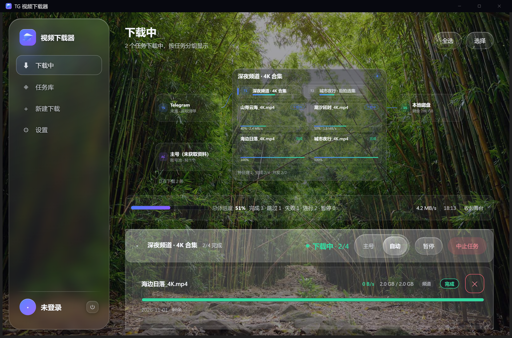
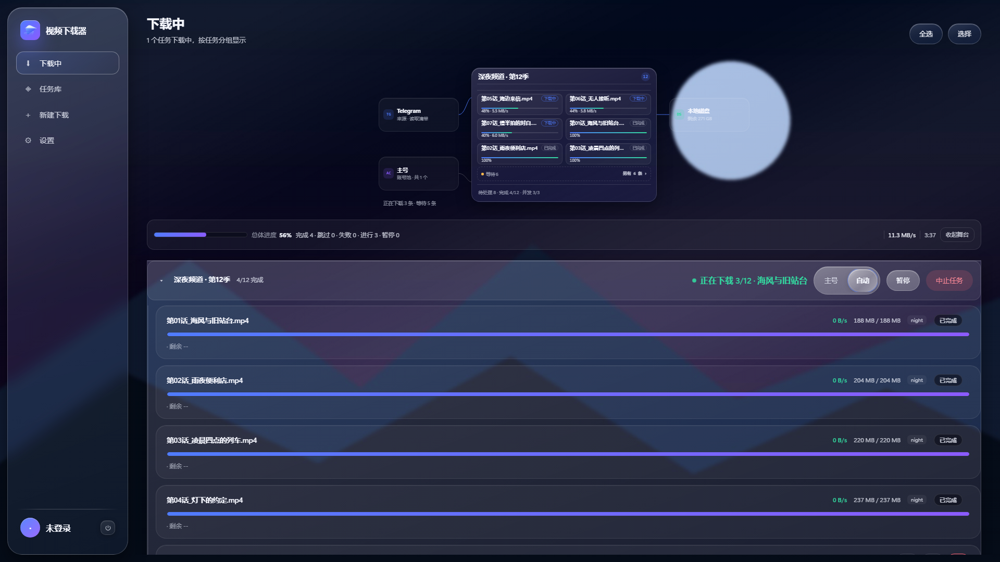
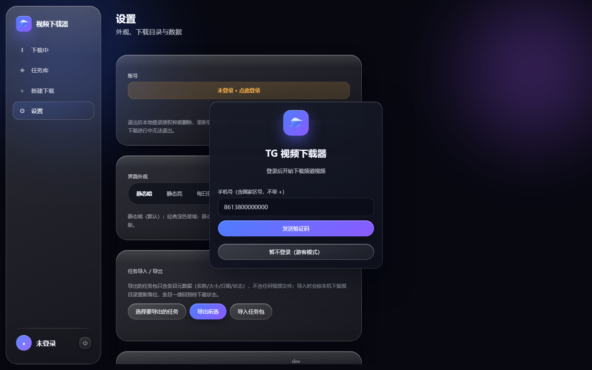
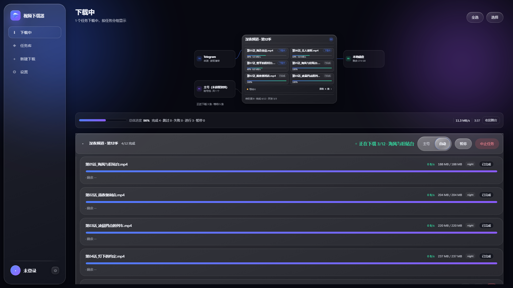
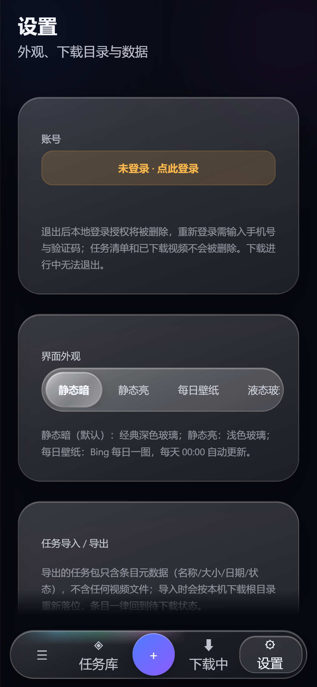

# v2.5.2 · 可读性、启动与壁纸稳定性修复

> 基于已发布的 v2.5.1，只修复产品 UI、可读性、启动耗时与发布截图问题；RPC 方法集、任务 JSON、数据目录和 NAS 部署路径保持兼容。

## 主要变化

- **启动更快**：桌面端不再在窗口出现前同步等待 Telegram 会话恢复，改为窗口先出现、前端首轮连接时恢复；headless 改为后台恢复。打包 EXE 窗口可见时间由 `22.61s` 降至约 `2s`。
- **登录弹层可读**：独立阅读遮罩 + v2.5.1 移动端 34px 毛玻璃卡面，暗色、亮色、每日壁纸、液态玻璃与桌面/平板/移动下都不会透读下层任务名、按钮或进度条。
- **平板白条**：768–1023px 断点与桌面统一关闭面板实时背景采样，修复卡片左缘玻璃白条。
- **移动外观选择器**：固定 2×2 网格，四项完整可见；选项与「导入任务包」同为 39px 紧凑胶囊，不再挤成一整块。
- **选中态统一**：底栏、分段控件、外观选择器共用高对比 thumb，保留弹簧位移与 reduced-motion 直切；布局变化后重新测量，不再偏移。
- **表单控件**：checkbox/radio 统一常态、hover、focus-visible、checked、disabled 五态，移除原生白色方块和灰圆点。
- **日期筛选**：高级筛选日期区间获得独立宽度，1280、1024、834、390 下完整显示、不重叠。
- **每日壁纸可读性**：舞台与内容面板增加 token 匹配阅读底，任务名、速度、剩余时间、状态和操作不被照片穿透。
- **壁纸切菜单不再闪**：壁纸/液态主题下跳过 View Transition，改用瞬时直切，避免快照丢失 `backdrop-filter` 导致右侧玻璃先透明再变暗。
- **移动命名区更紧凑**：操作按钮收紧到 32px，说明文字降到 11px，结果列表上方留出更多空间。
- **舞台账号**：资料未回填时显示「主号 / 小号」紧凑标签；任务引用小号而账号列表尚未到达时补出小号节点，不再只显示主号或「未获取资料」。
- **长路径**：中段省略，聚焦恢复完整值；设置页与独立任务编辑页提供复制/打开目录入口。

## 截图

同一页面、同一任务状态、同一尺寸，来自打包 EXE 与隔离 mock 数据。

| 静态暗 | 静态亮 | 每日壁纸 | 液态玻璃 |
| --- | --- | --- | --- |
|  |  |  |  |

| 登录 | 下载中 | 移动设置 |
| --- | --- | --- |
|  |  |  |

更多桌面、平板、移动与四档宽度截图见仓库 `docs/images/`。

## 兼容性

- RPC 方法集不变。
- 任务 JSON、数据目录、导出包与 NAS/Docker 路径不变。
- 无新增第三方运行时依赖。

## 验证

- 后端：`python -m pytest -q`，`359 passed`。
- 前端：`node --test "tests/js/*.test.mjs"`，`179 passed / 0 failed / 0 todo`。
- 打包 EXE 浏览器 smoke：`33 PASS / 0 FAIL`，覆盖登录、设置、四主题、新建下载两态、任务库、任务编辑、导入导出、Bing 明暗壁纸与 1280/1024/834/390 宽度。
- 截图矩阵覆盖 1920、1280、834、390，壁纸明暗各一档。
- NAS 独立测试容器：`tvg-v2-5-2-test`，18787 端口，数据卷 `tvg-v2-5-2-test-data`，不覆盖生产容器。
